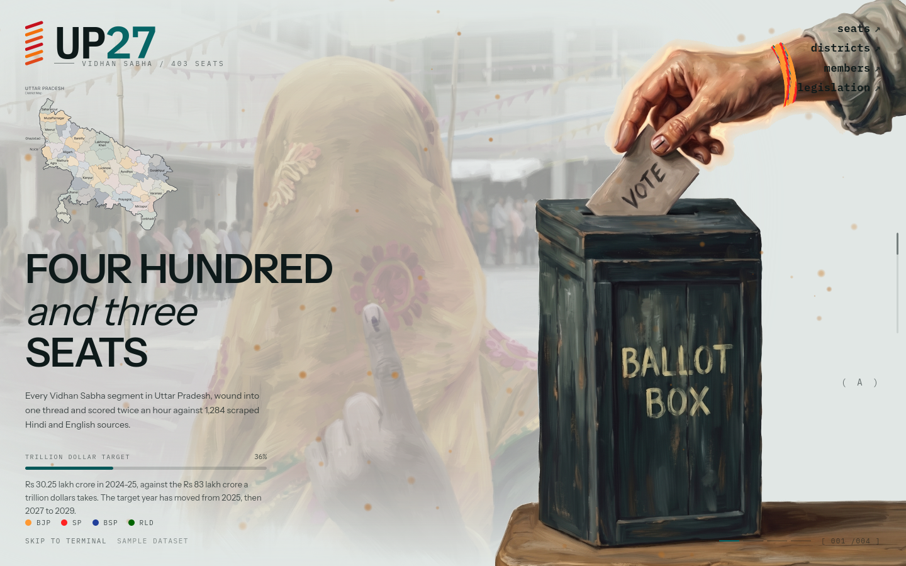

# UP27 — Uttar Pradesh 2027 Vidhan Sabha Election Intelligence Terminal

[](https://react.dev/)
[](https://vitejs.dev/)
[](https://tailwindcss.com/)
[](https://www.typescriptlang.org/)
[](https://d3js.org/)

> **A product-grade political intelligence terminal and continuous canvas scroll narrative for the 2027 Uttar Pradesh Legislative Assembly Election (403 Vidhan Sabha Seats).**

---

## 📸 Landing Page Preview

<p align="center">
  
</p>
<p align="center"><em>Real-time 60 FPS HTML5 Canvas scroll journey: From the voter's wrist kalawa thread into the 403-member Vidhan Sabha chamber, the district ring, and the full election matrix.</em></p>

---

## 🌟 Overview

**UP27** combines computational political science with high-precision generative design. It provides analysts, journalists, and voters with granular situational awareness across all **403 assembly constituencies** of Uttar Pradesh for the upcoming 2027 Vidhan Sabha elections.

The project features a **two-tier experience**:
1. **The Narrative Landing Page**: A continuous, high-performance `<canvas>` scroll journey interpolating through OkLab color space across four thematic acts.
2. **The Intelligence Terminal**: A dense, real-time command deck with force-directed neural graph analytics, constituency dossiers, MLA roll call, regional swing modeling, and demographic metrics.

---

## 🎨 The 4-Stage Canvas Narrative

The landing page runs on an uninterrupted frame-by-frame 2D Canvas engine with physics damping (`DAMPING = 0.08`):

1. **Stage A — The Vote (Daylight)**
   - Visualizes the sacred democratic act: a painted voter casting a ballot at a polling station.
   - The *Kalawa* sacred thread wrapped around the wrist is formed by **403 individual colored strands**, each representing one sitting MLA rendered in their party's official color.
   - Features real-time district hover lookups directly linked to the geographical state map.

2. **Stage B — The Assembly Chamber (Overcast)**
   - On scroll, the wrist thread unwinds dynamically into the legislative chamber benches of Lucknow's Vidhan Bhavan.
   - Visualizes real seat proportions across BJP, SP, RLD, SBSP, NISHAD, INC, JD(L), IND, and vacant seats.

3. **Stage C — The Ring & The State (Night)**
   - The assembly strands expand into a concentric district ring floating above cultural epicenters of Uttar Pradesh (*Ayodhya Deepotsav, Varanasi Ganga Aarti, Prayagraj Sangam Kumbh Mela, and Agra's Taj Mahal*).
   - Features dynamic luminance flicker, particulate dust, and twinkling celestial background effects.

4. **Stage D — The Lotus Bloom & Election Matrix (Mud / Earth)**
   - The strands assemble into a geometric multi-layered lotus flower and 403-seat grid.
   - Selecting any strand opens an interactive dossier tray displaying sitting member details, margin, office rank, and district statistics.

---

## ⚡ Terminal Core Features

- **Interactive 403-Constituency Map & Matrix**: Filter and color-code all seats by Incumbent Party, 2027 Projected Margin, Momentum Swing, or Anti-Incumbency index.
- **MLA Intelligence Dossiers**: Complete records for all 403 sitting representatives, including ministry portfolios, victory margins, and portrait images scraped from Wikidata and Wikimedia Commons.
- **Obsidian-Style Neural Knowledge Graph**: Force-directed D3 graph capturing breaking political news, neural impact pulses, and sentiment propagation across parties and key political figures.
- **District Bubbles & Regional Battleground Analytics**: Six regional zones analyzed: *Purvanchal, Paschim Pradesh, Awadh, Bundelkhand, Rohilkhand, and Baghelkhand*.
- **Statewide Pulse**: Live tracker for the 202-seat majority mark, alliance balance of power (NDA vs. PDA / INDIA Alliance vs. BSP), and macroeconomic indicators.
- **Bilingual News Stream & Law Tracker**: Real-time Hindi and English news feeds with automated issue tagging.

---

## 🤖 Built With & AI Attributions

This project integrates state-of-the-art AI development workflows and generative artistry:

- **Claude Code**: Architected the application logic, high-performance HTML5 Canvas physics, OkLab color transitions, D3 graph physics, React 19 component trees, and end-to-end full-stack development.
- **✨ Gemini / Sparkles**: Synthesized the rich Indian cultural artwork, historical landmark paintings (Ayodhya, Varanasi, Prayagraj, Taj Mahal), polling station backdrops, and generative asset design used across the landing scene.

---

## 📁 Repository Structure

```
UP_election/
├── frontend/                     # React 19 + Vite + Tailwind v4 Web Application
│   ├── public/                   # Processed artwork, GeoJSON, and MLA portraits
│   │   ├── mla/                  # 403 MLA portrait images (001.png - 403.png)
│   │   ├── places/               # Cultural landmark paintings (Ayodhya, Varanasi, etc.)
│   │   ├── scene.png             # The ballot box & voter hand scene
│   │   ├── voter.png             # Polling room background artwork
│   │   ├── parliament.png        # Vidhan Sabha chamber backdrop
│   │   └── up-constituencies.geojson # Official constituency geographic boundaries
│   └── src/
│       ├── components/           # UI components (Landing, Map, Dossier, Graph, etc.)
│       ├── data/                 # Datasets (mlas2026.ts, upConstituencies.ts, newsFeed.ts)
│       └── types/                # Strict TypeScript interfaces and schemas
├── data/                         # Ground truth data files
│   ├── uttar_pradesh_mlas_2026.csv # Roll call for all 403 Vidhan Sabha seats
│   └── india_youth_employment_education.csv # Comparative macro demographic dataset
├── docs/                         # Architecture documentation
│   ├── landing.png               # High-resolution landing page screenshot
│   ├── TUNING.md                 # Physics dials, OkLab thresholds, and canvas constants
│   └── DATA.md                   # Measurement methodologies, estimates, and licensing
├── scripts/                      # Data processing & scrape pipelines
│   ├── fetch_mla_photos.py       # Wikidata/Commons automated portrait pipeline
│   ├── gen_district_shapes.mjs   # Voronoi/GeoJSON district shape generator
│   └── link_photos.py            # Constituency to photo mapping script
└── source/                       # Raw source assets and references (git-ignored)
```

---

## 🚀 Getting Started

### Prerequisites

- **Node.js** (v18.0.0 or higher recommended)
- **npm** or **pnpm**
- **Python 3.10+** (only if running scrape/data generation scripts)

### Installation & Local Development

1. **Clone the repository**:
   ```bash
   git clone git@github.com:<username>/UP_election.git
   cd UP_election
   ```

2. **Install frontend dependencies**:
   ```bash
   cd frontend
   npm install
   ```

3. **Start the local development server**:
   ```bash
   npm run dev
   ```
   Open your browser at `http://localhost:5173`.

4. **Production Build**:
   ```bash
   npm run build
   ```
   The compiled assets will be output to `frontend/dist/`.

---

## 📊 Data Methodology

The roll call in `frontend/src/data/mlas2026.ts` is strictly derived from `data/uttar_pradesh_mlas_2026.csv`. 

- **Hard Facts**: Seat numbers (AC 1–403), MLA names, political party, district, assembly term start date, and verified executive offices (*Chief Minister, Deputy Chief Minister, Cabinet Minister, MoS*).
- **Model Estimates**: Fields marked `GUESS` in the source (such as district economic scale estimates or composite district sentiment scores) are solely used for visual sizing and relative weightings in the district ring, never represented as empirical fact. See [`docs/DATA.md`](docs/DATA.md) for full disclosure.

---

## 🛠️ Tuning the Experience

To customize damping, scroll speeds, OkLab color stages, thread thickness, or star particle density, refer to [`docs/TUNING.md`](docs/TUNING.md). All constants are centralized in `frontend/src/components/Landing.tsx`.

---

## 🔐 SSH & GitHub Access

To push or sync changes to your remote GitHub repository, make sure your GitHub account or repository Deploy Keys has this machine's public SSH key:

```text
ssh-ed25519 AAAAC3NzaC1lZDI1NTE5AAAAIPzuzZYA7SnMnMOZjN5UQnimx5xY2LAUg9tdjjdwqXwt parthsvault@gmail.com
```

Test your authentication at any time with:
```bash
ssh -T git@github.com
```
*(Authenticated as `PartheCraftyboy`)*

---

## ⚖️ License & Attribution

- MLA portraits are sourced under public domain / Creative Commons from [Wikidata](https://www.wikidata.org/) and [Wikimedia Commons](https://commons.wikimedia.org/).
- Code and terminal interface are available for non-commercial analysis and educational research.
